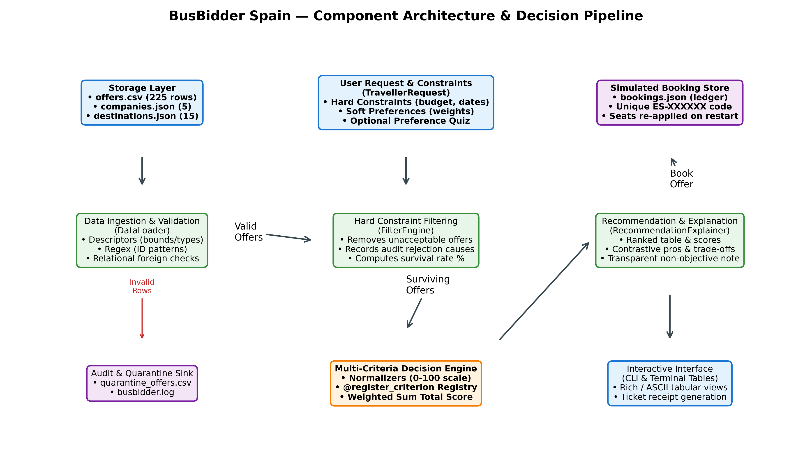
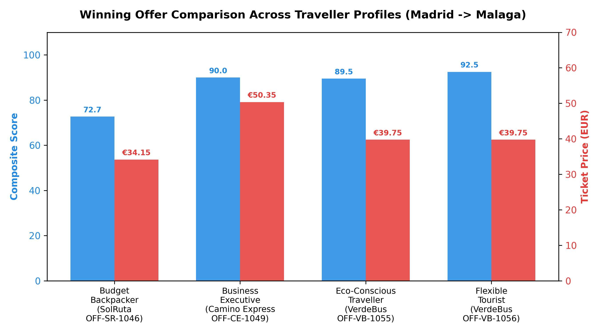

# BusBidder Spain: Filtering and Ranking Competing Bus Offers for Individual Travellers

*Final project report, ACIT4420 Problem-solving with scripting (2026)*

**Mehmood Hasan**  
Student number: **[TO COMPLETE: add your student number]**  
Department of Computer Science, OsloMet – Oslo Metropolitan University  
Source code: **[TO COMPLETE: add GitHub repository link and final commit hash]**  
Date: **[TO COMPLETE: submission date]**  

## Abstract

This report describes the design, implementation and evaluation of BusBidder Spain, a modular Python application that ranks simulated bus offers from five fictional companies serving fifteen destinations from Madrid. The application validates 225 offers loaded from files and places invalid records aside, removes the offers that break the traveller's hard constraints, and ranks the rest with a weighted sum of criteria normalised to 0–100. It explains the top offer and simulates a booking whose seat reductions persist between sessions. The application passes 38 automated tests, and four traveller profiles received clearly different and largely reasonable recommendations. The evaluation also showed sensitivities that the user cannot see: the specification's example request was decided by 0.03 points, adding a non-winning offer to the candidate pool changed the winner, and one company won none of 75 searches. The recommendation is therefore defensible only as the best compromise under the chosen constraints, weights and normalisation method.

## 1 Introduction

Comparing bus journeys means trading price against duration, departure time and ticket conditions. Sorting by a single attribute hides these trade-offs, and a business traveller values them very differently from a backpacker. This is a multi-criteria decision problem, for which the weighted sum model is one of the simplest and best-established methods (Hwang & Yoon, 1981; Triantaphyllou, 2000). Because the model adds criterion values together, the criteria must first be brought to a common scale (Section 5.2).

The project addresses the central question of the specification: *how can a Python application filter and rank competing bus offers according to the requirements and preferences of an individual traveller?* The project has four objectives: to build a modular, object-oriented application that loads and validates the data from files; to separate hard constraints from soft preferences visibly; to implement a reproducible weighted ranking with an explanation generated from the data; and to evaluate whether the rankings are reasonable for different travellers, and where they are not.

## 2 Problem interpretation and requirements

The task was interpreted as a two-stage pipeline. First, every offer is checked against conditions that the traveller cannot accept being broken, such as the destination, the travel window, free seats or a maximum price, and an offer that fails is removed without being scored. Second, the remaining offers are compared on criteria that the traveller is willing to trade against each other. The separation matters because a weighted score is compensatory: a very cheap ticket can make up for a poor departure time, so conditions that must never be compensated cannot be part of the score. Because the top offer is best only under the selected constraints, weights and scoring assumptions, the evaluation examines when the ranking is fragile as well as whether its winners are sensible.

Table 1 maps the requirements to their implementation and evidence (files listed in Appendix A). All journeys are one-way from Madrid between 12 and 14 July 2026, bookings are simulated without payment, and optional extensions such as a graphical interface were not implemented.

**Table 1.** Requirements of the specification and where they are met.

| Requirement (specification section) | Implementation | Evidence |
|---|---|---|
| Object-oriented model in several modules, with a diagram (Task 1, §7, §9) | Eight packages under `src/`; `report/architecture_diagram.png` | Section 3, Figure 1 |
| Load and validate data from files (Task 2) | `DataLoader`, descriptors, regex checks, quarantine CSV | Section 4, `05_quarantine_review.txt` |
| Custom exceptions and error categories (Task 2, §7) | `BusBidderError` hierarchy, including `DataFileMissingError` | Section 4.3, `07_missing_file_error.txt` |
| Log file of important events (Task 2) | `busbidder.log` written by `src/loaders/logger.py` | `08_busbidder_log_excerpt.log` |
| Hard constraints separated from preferences, visible to the user (Task 3) | `FilterEngine`; hard/soft summary printed before every ranking | Section 5.1, Table 4 |
| Weighted ranking with at least four criteria (§5) | Six registered criteria; every profile uses four | Section 5.2, Table 5 |
| Normalisation, direction, weight validation, ties, missing and extreme values, dominance (§5) | `normalizers.py`, `TravellerRequest.validate_weights`, `RankingEngine` | Sections 5.2–5.3 |
| Ranked list with values, criterion scores, total score and explanation (§6) | Two tables and an explanation panel per search | Section 5.4, `01_demo_four_profiles.txt` |
| At least three traveller profiles (§6) | Five profiles, four used in the comparison | Section 7.3 |
| Simulated booking with reference, capacity and fare conditions (§6) | `BookingManager`, `BookingRecord`, `data/bookings.json` | Section 6, `03_interactive_booking.txt` |
| Metaprogramming technique (§7) | Validation descriptors and the `@register_criterion` registry | Section 3.3 |
| Tests of normal, invalid, missing-data and boundary cases (§7) | 38 pytest tests in `tests/` | Section 7.1, `06_test_results.txt` |

## 3 Software design and architecture

### 3.1 Overall architecture

The application is a pipeline in which each stage has one responsibility (Figure 1). The loader reads and validates the files, returns `Offer` objects and sends invalid rows to a quarantine file. A `TravellerRequest` holds the hard constraints and the soft preferences. The filter engine removes unacceptable offers and records why, the ranking engine scores the rest, the explainer describes the winner, and the booking manager stores a booking. A pipeline mirrors the decision process in Section 2 and makes each stage testable in isolation.

**Figure 1.** Main components of BusBidder Spain and the flow of information between them.

### 3.2 Classes, inheritance and composition

`Offer` represents one departure and validates itself when it is created, so an existing `Offer` is always consistent. Only the loader and `BookingManager` access files, so the rest of the application can be tested without the disk. Inheritance is used only where a subclass is a true specialisation. All application errors inherit from `BusBidderError`, so `main.py` can catch every known error in one place and print a short message instead of a traceback. Elsewhere, object composition is favoured over class inheritance (Gamma et al., 1995). A `RankedOffer` contains an `Offer` rather than extending it, because a ranking is a view of an offer in one search, and the same offer receives different scores for different travellers. A `BookingRecord` copies the fare conditions at the time of booking, so a later change in the catalogue cannot alter a ticket that has already been sold.

### 3.3 Metaprogramming and regular expressions

Two metaprogramming techniques were used, each because it solved a concrete problem. The first is a set of data descriptors (`PositiveNumber`, `NonNegativeInt`, `BoundedFloat` and `RegexValidatedString`). A descriptor is an object that customises attribute lookup, storage and deletion, usually by defining `__get__` and `__set__` (Python Software Foundation, n.d.; Ramalho, 2022). Declaring `price = PositiveNumber()` on `Offer` means that every assignment to `price` is checked by the same code, also after construction, whereas checks in the constructor alone would be bypassed by later assignments such as a seat reduction.

The second is a registry built with a decorator. Each scoring criterion is a function decorated with `@register_criterion("name")`, which stores it in a dictionary. The ranking engine looks up the criteria named in the weights and never refers to a specific criterion, so a new criterion can be added without changing the engine, in line with the open–closed principle (Meyer, 1988). Regular expressions are used only for structured formats, such as offer identifiers (`^OFF-[A-Z]{2,4}-\d{4}$`), booking references, times and dates; numeric ranges are clearer as ordinary comparisons.

## 4 Dataset and validation

### 4.1 The simulated dataset

The marketplace consists of `companies.json`, `destinations.json` (fifteen destinations with distance from Madrid, region and coastal flag) and `offers.csv`. A deterministic generator (`src/loaders/generate_datasets.py`) produced the offers: each of the five companies serves every destination on three days, which gives the required 75 company–destination combinations and 225 offers. Price, duration and emissions follow company-specific rules based on distance (Table 2), and free seats vary from 15 to 49. The rules were chosen so that no company dominates. SolRuta is the cheapest but slow and inflexible, Camino Express the fastest and most flexible but the most expensive, VerdeBus has the lowest emissions and best rating, CostaLink the most luggage, and NocheVia travels overnight. Without such trade-offs, every traveller would receive the same recommendation.

**Table 2.** Fare rules used to generate the offers of each company.

| Company | Departures | Transfers | Fare conditions | Luggage | Rating | Price per km | CO₂ per km |
|---|---|---|---|---|---|---|---|
| SolRuta | 07:45, 11:30, 15:15 | 1 if > 450 km | Neither changeable nor refundable | 12 kg | 3.9 | €0.055 (+€5 with transfer) | 0.038 kg |
| Camino Express | 08:30, 14:00, 17:30 | Always direct | Changeable and refundable | 20 kg | 4.7 | €0.095 | 0.032 kg |
| CostaLink | 09:15, 13:45, 16:30 | Direct to the coast; 1 inland if > 400 km | Changeable only | 25 kg | 4.3 | €0.068 coast, €0.082 inland | 0.035 kg |
| VerdeBus | 10:00, 15:00 | Always direct | Changeable and refundable | 18 kg | 4.8 | €0.075 | 0.014 kg |
| NocheVia | 22:30, 23:45 | Always direct | Changeable only | 20 kg | 4.2 | €0.065 | 0.030 kg |

### 4.2 Validation and quarantine

Each row is converted to the correct types and checked before it becomes an `Offer` (Table 3). The file `data/corrupt_offers_sample.csv` contains five deliberately broken rows that show the checks working on a real file. Invalid rows are placed aside rather than corrected: they are written to `data/quarantine_offers.csv` with their line number and the reason, the event is logged, and the remaining rows still load. Automatic correction was rejected because a correction is a guess. A negative price could be a sign error or a refund, and showing a traveller a guessed price is worse than not showing the offer. Two exceptions are deliberate. An offer with zero free seats is valid data, because a sold-out departure is normal, and it is removed by the seat constraint instead. If the emissions column is missing entirely, a default of 12 kg per passenger is used, a weakness discussed in Section 8.4.

**Table 3.** Validation checks applied to each offer.

| Check | Mechanism | Example rejected in the corrupt sample |
|---|---|---|
| Offer identifier has the expected structure | Regular expression | `INVALID-ID` |
| Company and destination exist in the catalogue | Lookup in the loaded JSON files | Destination "Atlantis" |
| Date and times have valid formats | Regular expression and calendar parsing | – |
| Price and duration are positive numbers | `PositiveNumber` descriptor | Price of €−25.50 |
| Transfers and free seats are whole numbers ≥ 0 | `NonNegativeInt` descriptor | – |
| Customer rating lies between 1.0 and 5.0 | `BoundedFloat` descriptor | Rating of 7.5 |
| Departure, arrival and duration agree (overnight journeys allowed, 30 minutes tolerance) | Check in the `Offer` constructor | 23:00 to 05:00 stated as 120 minutes |
| Required values are present | Type conversion fails on empty fields | Tested with empty price and departure time |

### 4.3 Error categories and logging

Errors fall into three categories that match the pipeline: data errors (`DataValidationError`, `DataFileMissingError`), request errors (`ConstraintViolationError`, `WeightValidationError`) and booking errors (`SeatUnavailableError`, `InvalidBookingReferenceError`). Invalid rows are quarantined, while a missing data file stops the program with a short message and exit code 1. Loading, filtering, ranking and booking events are logged with timestamps in `busbidder.log`.

## 5 Filtering and ranking model

### 5.1 Hard constraints and soft preferences

A condition is a hard constraint when breaking it makes the offer useless regardless of its other qualities, and a soft preference when a better value elsewhere could reasonably make up for it (Table 4). The destination, travel window and free seats are always hard; the other hard constraints are optional, so the traveller decides whether, for example, a budget is a firm limit. Price and flexibility appear on both sides on purpose: below the budget a cheaper offer is still preferred. To make the distinction visible, the program asks for hard and soft conditions in separate steps and, before every ranking, prints them under separate headings with the number of offers each constraint removed.

**Table 4.** Division of the traveller's conditions into hard constraints and soft preferences.

| Condition | Type | Justification |
|---|---|---|
| Destination and travel window | Hard (always) | An offer to another city or on another day does not answer the request. |
| Enough free seats | Hard (always) | An offer that cannot be booked is not a real option. |
| Maximum price | Hard (optional) | A budget limit is usually a firm limit; below the limit, price is also a soft criterion. |
| Maximum transfers, maximum duration, minimum luggage | Hard (optional) | These are practical limits, for example a traveller with heavy luggage cannot use a 12 kg allowance. |
| Changeable or refundable ticket required | Hard (optional) | When required, a non-flexible fare is unacceptable; otherwise flexibility is scored. |
| Price, duration, departure time, flexibility, rating, emissions | Soft (weighted) | Better values are preferred but can be traded against each other. |

### 5.2 Normalisation and weights

The criteria are measured in different units, so each is converted to a score from 0 to 100 by min–max normalisation over the offers that survived the filter. For criteria where a lower value is better, the formula is reversed, so the best value always receives 100:

`lower is better:  score = (max − x) / (max − min) × 100`

`higher is better:  score = (x − min) / (max − min) × 100`

Departure time has no natural range. It is scored by the distance from the preferred time on a 24-hour clock, so that 23:00 and 01:00 are two hours apart, and the score falls linearly to 0 at eight hours:

`departure score = max(0, (8 − d) / 8 × 100),  where d = min(|h − t|, 24 − |h − t|)`

Flexibility gives 0.4 points for a changeable and 0.6 for a refundable fare before normalisation. Table 5 lists the six registered criteria. Each profile uses four, and the total score is their weighted sum:

`Score(j) = Σ wᵢ · Sᵢ(j),  with Σ wᵢ = 1`

**Table 5.** Criteria available for ranking.

| Criterion | Raw value | Direction | Normalisation |
|---|---|---|---|
| Price | Euro | Lower is better | Reversed min–max |
| Duration | Minutes | Lower is better | Reversed min–max |
| Departure time | Hours from preferred time | Closer is better | Fixed 8-hour scale on a 24-hour clock |
| Flexibility | 0, 0.4, 0.6 or 1.0 | Higher is better | Min–max |
| Customer rating | 1.0–5.0 stars | Higher is better | Min–max |
| Emissions | kg CO₂ per passenger | Lower is better | Reversed min–max |

Weights must be non-negative and sum to 1.0 (tolerance 0.001); otherwise a `WeightValidationError` is raised. Travellers choose a predefined profile or rate five factors from 1 to 5, and the ratings are divided by their sum. The common scale stops large raw numbers such as euros from outweighing stars, and the weight sum caps each criterion's contribution. This does not prevent dominance completely, because min–max stretches even tiny differences to the full range (Section 8.1).

### 5.3 Ties, missing values and extreme values

Equal total scores are ordered by lower price, higher rating and then shorter duration; remaining ties keep the catalogue order, so the order is reproducible. Missing values never reach the ranking, because such rows are quarantined. If all offers share one value on a criterion, all receive 100, which avoids division by zero. Impossible values are rejected, but unusual yet possible values, such as a very expensive offer, are kept because they may suit a business traveller.

### 5.4 Generating the explanation

The explanation is generated from the data. It lists the winner's advantages, such as the lowest price, and its remaining disadvantages, such as how many euros more it costs than the cheapest offer. Miller (2019) shows that people ask why one outcome occurred instead of another, and expect one or two main causes rather than a complete account. The explanation therefore compares the winner with the runner-up, names at most the two criteria that gave it the largest lead, and warns when the lead is below two points. It always states that the offer is the best fit under the traveller's constraints and weights, not objectively superior.

## 6 Simulated booking

The traveller selects an offer by its rank and enters a name and the number of seats. `BookingManager` raises a `SeatUnavailableError` if too few seats remain. Otherwise it reduces the seats, generates a unique reference matching `^ES-[A-Z0-9]{6}$`, stores the fare conditions in the booking, writes it to `data/bookings.json` and prints a ticket. To keep capacity consistent without rewriting the catalogue, the booking file acts as a ledger: at start-up, the seats of all confirmed bookings are subtracted from the loaded offers. In the evidence run, booking two seats on OFF-SR-1001 reduced its capacity from 15 to 13, and the reduction remained after a restart (Appendix A, files 03 and 04).

## 7 Testing and experimental evidence

### 7.1 Automated tests

All 38 pytest tests pass (Table 6). They cover the four kinds of case in the specification: normal cases, invalid data such as negative prices and inconsistent timetables, missing data such as a missing file or an empty price, and boundary cases such as equal values, departures around midnight, zero seats and seat exhaustion.

**Table 6.** Automated tests per module.

| Test module | Tests | What is tested |
|---|---|---|
| `test_descriptors_and_models.py` | 8 | Valid offers; negative price, bad identifier, rating out of range and timetable errors; invalid and negative weights; reversed travel window |
| `test_loaders.py` | 6 | Catalogue files, valid offers, quarantine of the corrupt sample, missing file, missing field values, zero seats |
| `test_filters.py` | 4 | Destination and dates, budget, direct-only, mandatory flexibility |
| `test_ranker_and_normalizers.py` | 6 | Both normalisation directions, equal values, 24-hour clock, registry, ranking and explanation |
| `test_booking.py` | 6 | Booking lifecycle, seat exhaustion, invalid reference, cancellation, capacity after restart |
| `test_preference_quiz.py` | 3 | Ratings to weights, equal ratings, use in a request |
| `test_profile_divergence.py` | 1 | Different profiles produce different winners on the same data |
| `test_interactive_helpers.py` | 4 | Specification example request, combining limits, hard/soft summary, missing-file error |

### 7.2 The specification's example request

The example request was entered in the interactive mode: Madrid to Malaga, 12–14 July, a maximum of €50, at most one transfer, a changeable ticket, a morning departure and the specification's weights. Nine of the 15 offers survived. SolRuta was removed as non-changeable, and Camino Express because it costs €50.35, €0.35 above the limit. Table 7 shows the top three.

**Table 7.** Top three offers for the specification's example request (scores 0–100; Dur. = duration, Dep. = departure time, Flex. = flexibility).

| # | Offer and departure | Price | Duration | Fare | Price score | Dur. score | Dep. score | Flex. score | Total |
|---|---|---|---|---|---|---|---|---|---|
| 1 | CostaLink OFF-CL-1052, 12 Jul 09:15 | €36.04 | 7 h 07 min | Changeable | 70.0 | 62.5 | 96.9 | 0.0 | 58.2 |
| 2 | VerdeBus OFF-VB-1055, 12 Jul 10:00 | €39.75 | 6 h 55 min | Fully flexible | 0.0 | 100.0 | 87.5 | 100.0 | 58.1 |
| 3 | VerdeBus OFF-VB-1057, 14 Jul 10:00 | €39.75 | 6 h 55 min | Fully flexible | 0.0 | 100.0 | 87.5 | 100.0 | 58.1 |

CostaLink is €3.71 cheaper and departs closer to the preferred time, while VerdeBus is faster and fully flexible. The totals differ by only 0.03 points, and the program warned that the result was a close call. Both offers are reasonable answers, and the program presents them as such.

### 7.3 Comparison of four traveller profiles

Four profiles were compared on the same route and travel window (Tables 8 and 9; full output in `outputs/01_demo_four_profiles.txt`).

**Table 8.** Traveller profiles used in the comparison.

| Profile | Weights | Hard constraints | Preferred departure |
|---|---|---|---|
| Budget backpacker | Price 60%, duration 15%, departure 15%, flexibility 10% | Price ≤ €45, at most 1 transfer | Morning (09:00) |
| Business executive | Duration 40%, departure 30%, flexibility 20%, price 10% | Direct only, changeable ticket | 08:30 |
| Eco-conscious traveller | Emissions 50%, rating 20%, duration 15%, price 15% | None beyond destination, dates and seats | Not weighted |
| Flexible tourist | Flexibility 45%, rating 20%, departure 20%, price 15% | Luggage ≥ 15 kg | Afternoon (14:00) |

**Table 9.** Winning offer for each profile, Madrid to Malaga, 12–14 July 2026.

| Profile | Offers left | Winner | Price | Duration | Fare | Score | Runner-up (score) |
|---|---|---|---|---|---|---|---|
| Budget backpacker | 12 of 15 | SolRuta OFF-SR-1046, 12 Jul 07:45 | €34.15 | 7 h 48 min, 1 transfer | Not flexible | 72.7 | SolRuta OFF-SR-1047 (70.3) |
| Business executive | 12 of 15 | Camino Express OFF-CE-1049, 12 Jul 08:30 | €50.35 | 6 h 26 min, direct | Fully flexible | 90.0 | VerdeBus OFF-VB-1055 (72.0) |
| Eco-conscious traveller | 15 of 15 | VerdeBus OFF-VB-1055, 12 Jul 10:00 | €39.75 | 6 h 55 min, direct | Fully flexible | 89.5 | VerdeBus OFF-VB-1056 (89.5, tie) |
| Flexible tourist | 12 of 15 | VerdeBus OFF-VB-1056, 13 Jul 15:00 | €39.75 | 6 h 55 min, direct | Fully flexible | 92.5 | VerdeBus OFF-VB-1055 (85.0) |

**Figure 2.** Total score and price of the winning offer for each profile. The scores are relative to each profile's own candidate pool and cannot be compared between profiles.

Three different companies won, so the model responds to the traveller's preferences. The budget backpacker received the cheapest offer, the business executive the fastest direct offer at the preferred time (with the explanation noting that it costs €15.90 more than the cheapest), the eco-conscious traveller the lowest-emission company and the flexible tourist the fully flexible afternoon departure.

### 7.4 Are the rankings reasonable?

The business and flexible-tourist winners led by 18.0 and 7.5 points and match their profiles. The eco-conscious choice of company is reasonable, but the choice between three identical VerdeBus departures is arbitrary, which the program now states. The comparison also exposed a bug: an earlier explainer commented on departure time although it was not weighted. It was fixed, which shows that explanations must be tested as carefully as scores.

The budget result is the most debatable. SolRuta won with 72.7, but the third-placed CostaLink offer (69.9) is direct, 41 minutes faster, changeable and has twice the luggage allowance for only €1.89 more. Min–max normalisation gave the cheapest offer 100 price points and CostaLink 66.2, so with a price weight of 60%, €1.89 became 20.3 weighted points. The result follows the stated priorities, but the normalisation, and not only the weights, shaped it.

### 7.5 Robustness checks

Three further checks were made. First, moving five percentage points between price and duration reversed the result: VerdeBus won by 5.3 points at 35/30, and CostaLink by 5.4 points at 45/20. Second, raising the budget from €50 to €51 admitted the three Camino Express offers, none of which wins, yet the winner changed to VerdeBus, whose score rose from 58.1 to 72.9. The most expensive offer defines the zero point of the price score, so VerdeBus's price score rose from 0 to 66.7 once it was no longer the most expensive. This is rank reversal, first discussed for the analytic hierarchy process by Belton and Gear (1983): a recommendation can depend on offers the traveller will never choose. Third, all five profiles were run on all fifteen destinations (Table 10). NocheVia won none of the 75 searches, and CostaLink only one.

**Table 10.** Number of destinations (out of 15) on which each company produced the winning offer.

| Profile | SolRuta | Camino Express | CostaLink | VerdeBus | NocheVia |
|---|---|---|---|---|---|
| Budget backpacker | 12 | 1 | 1 | 1 | 0 |
| Business executive | 0 | 15 | 0 | 0 | 0 |
| Eco-conscious traveller | 0 | 0 | 0 | 15 | 0 |
| Flexible tourist | 0 | 0 | 0 | 15 | 0 |
| Balanced (specification weights) | 0 | 1 | 0 | 14 | 0 |
| Total of 75 searches | 12 | 17 | 1 | 45 | 0 |

## 8 Evaluation, limitations and possible unfair outcomes

The results answer the central question: the application filters and ranks offers according to individual requirements, and its recommendations change sensibly with the preferences. The evaluation also revealed weaknesses that a traveller would not notice, discussed below from the most serious.

### 8.1 Min–max normalisation amplifies small differences

Min–max normalisation stretches the observed range to 0–100, however small it is. For the budget backpacker on the Malaga route, the remaining prices varied by only €5.60 but filled 100 price points: a difference of €0.30 between SolRuta and NocheVia was worth 5.4 points, and VerdeBus, the fastest, direct and fully flexible offer, finished last because it was the most expensive. The choice of normalisation method is known to influence multi-criteria rankings (Jahan & Edwards, 2015). Scoring price against a fixed reference, such as the traveller's budget, would keep small differences small.

### 8.2 Rankings depend on the candidate pool

Because scores are relative to the pool, adding or removing an offer can reorder the others (Section 7.5). A traveller who widens the budget by one euro may receive a different recommendation for reasons unrelated to it, and a company could in principle affect its competitors' ranks by adding or withdrawing an expensive offer. Scores also cannot be compared across searches: the flexible tourist's 92.5 does not mean that this traveller was better served than the budget backpacker with 72.7.

### 8.3 Hard constraints create sharp edges

A hard constraint treats a miss of one cent like a miss of fifty euros. In the example request, the fastest and most flexible offer was excluded for being €0.35 over budget. This is correct for a firm limit, but the traveller is not told that a much better offer was only just outside it. Reporting near misses, for example offers within 5% of a numeric limit, would help.

### 8.4 Possible unfair outcomes

Friedman and Nissenbaum (1996) distinguish preexisting, technical and emergent bias in computer systems. Their main example of technical bias is an airline reservation system whose ranking systematically places some airlines' flights on later screens. BusBidder Spain shows the same kind of bias. NocheVia's departures at 22:30 and 23:45 are more than eight hours from every daytime preference and receive 0 departure points, while the model has no criterion for the benefits of overnight travel, such as saving a night's accommodation. One type of service is thus systematically disadvantaged by what the model chooses to measure. CostaLink's main strength, its 25 kg luggage allowance, is likewise only a hard constraint and is never rewarded.

Defaults matter as well. A traveller who states no departure preference receives "morning", which steers them away from overnight services. A single fixed rating per company rewards the brand rather than the departure, and the default emission value for missing data (Section 4.2) would make an unmeasured service look average, which may favour a polluter that does not report its emissions.

### 8.5 Other limitations

The data are simulated, so the results show how the model behaves, not how real companies compare. Normalisation removes the partial credit for changeable fares when every remaining offer is changeable. A traveller who rates every questionnaire factor as crucial obtains equal weights; a pairwise method such as the analytic hierarchy process (Saaty, 1980) would force trade-offs at the cost of more questions. The JSON booking ledger is not safe for simultaneous sessions.

### 8.6 Possible improvements

A further version should score price and duration against fixed reference points, such as the budget and the fastest possible journey, to reduce both amplification and rank reversal; score flexibility on its fixed scale; report near misses; and add a criterion for overnight travel or a "no preference" option for departure time. The close-call warning should be kept, since it is the simplest way of telling the traveller that a recommendation is fragile.

## 9 Reproducibility

The application was developed with Python 3.13 on Windows 11. It uses `rich` for tables (optional) and `pytest` for the tests; `matplotlib` and `python-docx` are only needed to rebuild the report. All are listed in `requirements.txt`. The dataset generator is deterministic and the ranking contains no random elements, so the results can be reproduced exactly with the commands in Table 11, which are also given in the README.

**Table 11.** Commands used to produce the evidence in this report.

| Purpose | Command |
|---|---|
| Install dependencies | `python -m pip install -r requirements.txt` |
| Four-profile comparison (Section 7.3) | `python main.py --demo` |
| Interactive search and booking (Sections 6 and 7.2) | `python main.py --interactive` |
| Quarantine review (Section 4) | `python main.py --quarantine` |
| Automated tests (Section 7.1) | `python -m pytest -v` |

## 10 Declaration of generative AI use

I confirm that digital tools were used to support the development of this report. Generative AI was applied during the early stages to assist with brainstorming, structuring ideas, and exploring alternative perspectives relevant to the topic. In addition, language-enhancement software was used to review grammar, clarity, and flow. All analytical choices, interpretations, and final written content were produced and critically revised by me. The work presented here reflects my own understanding and independent academic judgment, in accordance with OsloMet’s guidelines for responsible use of digital assistance.

## 11 Conclusion

BusBidder Spain answers the central question with a two-stage pipeline: hard constraints remove unacceptable offers, and a weighted sum of normalised criteria ranks the rest, using independent, tested components. The same 225 offers produced different and largely reasonable recommendations for different travellers. The evaluation also showed that a transparent formula is not necessarily a stable or fair one: the example request was decided by 0.03 points, a one-euro change in the budget changed the winner, and one company never won because of what the model measures. A recommendation is therefore best understood as the best compromise under the traveller's constraints, weights and the chosen normalisation, and the application says so when the margin is small.

## References

Belton, V., & Gear, T. (1983). On a short-coming of Saaty's method of analytic hierarchies. *Omega, 11*(3), 228–230. https://doi.org/10.1016/0305-0483(83)90047-6  
Friedman, B., & Nissenbaum, H. (1996). Bias in computer systems. *ACM Transactions on Information Systems, 14*(3), 330–347. https://doi.org/10.1145/230538.230561  
Gamma, E., Helm, R., Johnson, R., & Vlissides, J. (1995). *Design patterns: Elements of reusable object-oriented software*. Addison-Wesley.  
Hwang, C.-L., & Yoon, K. (1981). *Multiple attribute decision making: Methods and applications*. Springer. https://doi.org/10.1007/978-3-642-48318-9  
Jahan, A., & Edwards, K. L. (2015). A state-of-the-art survey on the influence of normalization techniques in ranking: Improving the materials selection process in engineering design. *Materials & Design, 65*, 335–342. https://doi.org/10.1016/j.matdes.2014.09.022  
Meyer, B. (1988). *Object-oriented software construction*. Prentice Hall.  
Miller, T. (2019). Explanation in artificial intelligence: Insights from the social sciences. *Artificial Intelligence, 267*, 1–38. https://doi.org/10.1016/j.artint.2018.07.007  
OsloMet – Oslo Metropolitan University. (2026). *Veileder for bruk av kunstig intelligens (KI) i studentoppgaver* [Guide to the use of artificial intelligence in student assignments]. Retrieved October 30, 2026, from https://student.oslomet.no/en/veiledning-kunstig-intelligens-studentoppgaver  
Python Software Foundation. (n.d.). *Descriptor guide*. Python documentation. Retrieved October 30, 2026, from https://docs.python.org/3/howto/descriptor.html  
Ramalho, L. (2022). *Fluent Python: Clear, concise, and effective programming* (2nd ed.). O'Reilly Media.  
Saaty, T. L. (1980). *The analytic hierarchy process*. McGraw-Hill.  
Triantaphyllou, E. (2000). *Multi-criteria decision making methods: A comparative study*. Springer. https://doi.org/10.1007/978-1-4757-3157-6  

## Appendix A. Evidence files

The following files in the `outputs/` folder were produced with the commands in Section 9 and contain the complete program output behind the tables and figures in this report.

**Table 12.** Evidence files in the outputs folder.

| File | Content |
|---|---|
| `01_demo_four_profiles.txt` | Hard/soft summary, ranked offers, criterion scores and explanation for the four profiles (Section 7.3) |
| `02_specification_example_request.txt` | Interactive run of the specification's example request (Section 7.2) |
| `03_interactive_booking.txt` | Interactive search and booking of two seats, with the printed ticket (Section 6) |
| `04_capacity_after_restart.txt` | Seat capacity of the booked offer after the program is restarted (Section 6) |
| `05_quarantine_review.txt` | The five rejected rows of the corrupt sample and their reasons (Section 4) |
| `06_test_results.txt` | Verbose output of the 38 automated tests (Section 7.1) |
| `07_missing_file_error.txt` | Program behaviour when a data file is missing (Section 4.3) |
| `08_busbidder_log_excerpt.log` | Log entries written while the evidence above was produced |
